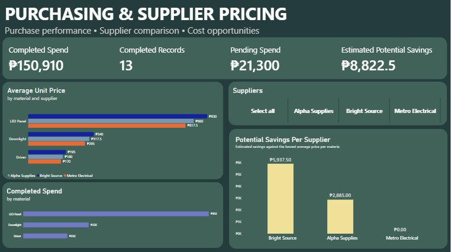

# Purchasing & Supplier Pricing Analysis

**Tools:** Power BI, DAX\
**Dataset:** Simulated purchasing transactions\
**Reporting period:** January--February 2026

## Overview

This portfolio project explores purchasing expenditure, purchase status,
supplier pricing, and potential cost-saving opportunities using a
simulated purchasing dataset. An interactive Power BI report was
developed to summarize key purchasing metrics and compare average unit
prices across suppliers for each material category.

The project demonstrates how purchasing data can be transformed into
business-focused metrics and visual insights. The dataset is synthetic
and does not represent actual company transactions or supplier
quotations.

## Business Questions

-   What is the value of completed and pending purchases?
-   Which material categories account for the largest share of completed
    spend?
-   How do average unit prices differ between suppliers for the same
    material?
-   What potential savings opportunities are suggested by the observed
    price differences?

## Tools Used

-   **Power BI Desktop** --- report visuals and interactive filtering
-   **DAX** --- purchasing KPIs, average unit prices, and estimated
    savings calculations
-   **CSV** --- source data imported into Power BI
-   **SQL** --- Data filtering queries

## Dataset

The simulated dataset contains 15 purchasing records from January and
February 2026. Fields include:

-   Purchase ID
-   Purchase date
-   Supplier
-   Material
-   Quantity
-   Unit price
-   Purchase status

The dataset includes three suppliers --- Alpha Supplies, Bright Source,
and Metro Electrical --- and three material categories: LED Panel,
Downlight, and Driver.

## Key Findings

### Purchasing Status and Expenditure

| Metric                         | Result       |
|--------------------------------|-------------:|
| Completed purchasing spend     | ₱150,910.00  |
| Pending purchasing value       | ₱21,300.00   |
| Completed purchase records     | 13 of 15     |
| Estimated potential savings    | ₱8,822.50    |

### Completed Spend by Material

| Material       | Completed Spend |
|----------------- |--------------------------:|
| LED Panel  | ₱94,910.00           |
| Downlight   | ₱33,475.00           |
| Driver          | ₱22,525.00           |
| **Total**    | **₱150,910.00**  |

LED Panels account for approximately 62.9% of completed purchasing
spend, making them a useful priority for further pricing review.

### Lowest Recorded Average Unit Price by Material

| Material       | Lowest Average Unit Price | Supplier                  |
|-----------------|---------------------------------------:|---------------------------|
| LED Panel  | ₱817.50                                | Metro Electrical     |
| Downlight   | ₱295.00                                | Metro Electrical     |
| Driver          | ₱170.00                                | Metro Electrical     |

Within this sample, Metro Electrical has the lowest recorded average
unit price for all three material categories. Price alone, however, does
not establish the best supplier; product specifications, quality,
delivery reliability, availability, and purchasing terms should also be
assessed.

### Estimated Potential Savings by Supplier

  Supplier             Estimated opportunity
  ------------------ -----------------------
  Bright Source                    ₱5,937.50
  Alpha Supplies                   ₱2,885.00
  Metro Electrical                     ₱0.00
  **Total**                    **₱8,822.50**

The estimate compares each supplier's average price with the lowest
recorded average price for the same material, then applies the
difference to quantities purchased from higher-priced suppliers.

These values are indicative opportunities for further investigation, not
confirmed or realized savings.

## Recommendations

1.  Review LED Panel purchasing costs because this category represents
    the largest share of completed spend.
2.  Investigate price differences for Bright Source and Alpha Supplies,
    comparing equivalent products and specifications before negotiating.
3.  Evaluate quality, technical compliance, delivery performance,
    supplier capacity, and contract terms alongside unit price.
4.  Review pending transactions and keep purchase statuses up to date.
5.  Refresh the analysis with actual purchasing data over a longer
    period to monitor price trends and assess whether negotiated savings
    are realized.

## Methodology and Limitations

The analysis uses a small synthetic dataset created for portfolio and
learning purposes. The estimated savings calculation uses the lowest
recorded average unit price for each material as a benchmark and applies
the difference to quantities purchased from higher-priced suppliers.

The dataset does not verify whether suppliers could fulfill all
quantities at the benchmark price. It also does not account for all
possible differences in product specifications, quality, freight,
discounts, minimum order quantities, payment terms, or supplier
capacity. As a result, the savings figure is an estimate for
investigation rather than a guaranteed financial outcome.

The short reporting period and small number of transactions also limit
conclusions about long-term price trends and overall supplier
performance.

## Project Structure

``` text
Supplier-Pricing-Analysis/
├── README.md
├── powerbi/
│   └── supplier_pricing_visuals.pbix
├── data/
│   └── purchases.csv
├── screenshots/
│   └── dashboard.png
├── report/
│   └── Supplier_Pricing_Analysis.pdf
└── sql/
    └── average_unit_price.sql
    └── estimated_potential_savings.sql
    └── supplier_pricing.db
```

Adjust the filenames and folders to match the files actually included in
the repository. The `sql/` folder is optional until project-related SQL
scripts are ready.

## How to Explore the Project

1.  Open `screenshots/dashboard.png` for a quick overview.
2.  Read the PDF analysis report for findings, recommendations, and
    limitations.
3.  If Power BI Desktop is installed, open the `.pbix` file to explore
    the report and supplier slicer.
4.  Review `data/purchases.csv` to inspect the simulated source
    transactions.

## Screenshots



## Conclusion

This project demonstrates the use of Power BI and DAX to monitor
purchasing expenditure, compare supplier prices within material
categories, and identify potential cost-saving opportunities. With
actual purchasing records and additional supplier-performance
information, this approach could support more informed procurement
decisions and ongoing cost-control reviews.
